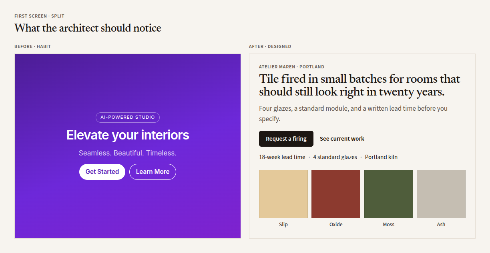
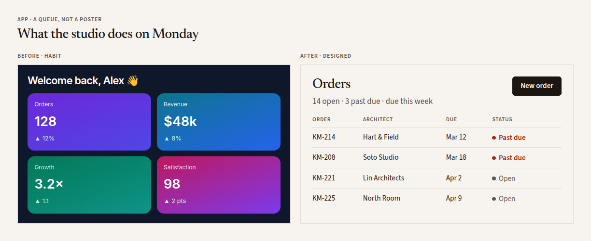
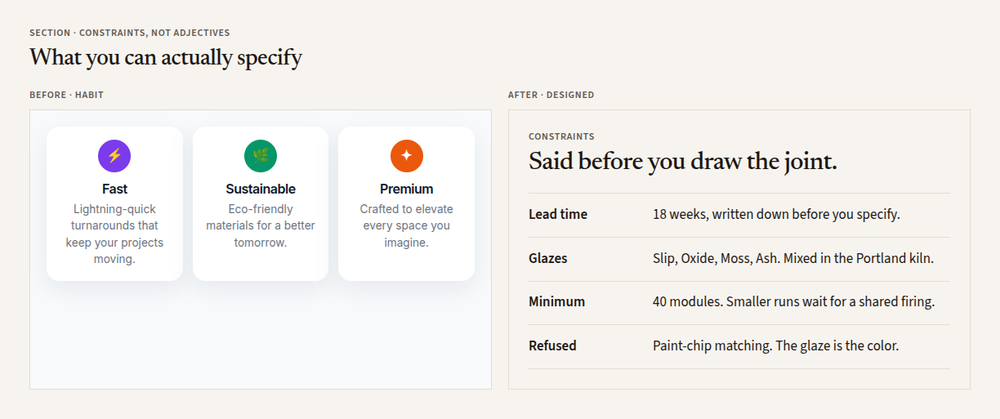

# Design taste skills

Give your coding agent a point of view before it writes the interface.

Most generated UI looks the same: a purple gradient, three identical cards, two pills labeled "Get Started" and "Learn More", and a number with no time window. The model reached for "looks designed" and stopped. These skills make it decide who the screen is for, what that person is trying to finish, and what they should notice first. Then they set type, space, color, and motion to match that decision.

Eleven skills. One installer. The stack you already have. [MIT licensed](LICENSE).

By [Imran Ahmed](https://imrandev.bd).



The page above is the same brief twice. Atelier Maren is a fictional kiln in Portland. On the left, the draft an agent writes from habit. On the right, the draft after `design-taste` and `landing-page`: a claim the studio can keep, one action, and the four glazes a specifier actually needs to see. Open the full comparison in [`examples/gallery.html`](examples/gallery.html).

## What you can do with it

Install the skills once. After that, any agent that reads them can take on the UI work you would otherwise brief, reject, and brief again.

| You want | What to ask for | Skills that load |
| --- | --- | --- |
| A new marketing page that could only belong to this product | "Design the homepage. Use design-taste and landing-page." | `design-taste`, `landing-page` |
| A first screen with a real structure | "Pick a structure and say why. Statement, split, specimen, index, argument, or workbench." | `landing-page` |
| An app a person uses every morning | "This is a queue, not a poster. Use dashboard." | `design-taste`, `dashboard` |
| A button, form, dialog, or empty state that is finished | "Build the component with every state. Use components." | `components` |
| Type that has a hierarchy | "Set four roles and a measure. Use typography." | `typography` |
| A layout that is grouped by meaning | "Use the spacing scale. No card around every idea." | `spacing` |
| A palette you can defend | "One temperature, one accent or none, contrast checked. Use color." | `color` |
| Dark mode that is designed | "Pair the tokens and add a theme toggle that does not flash." | `color`, `theming` |
| Motion that explains a change | "Animate the dialog only. Respect reduced motion." | `motion` |
| A pass that removes the generic look | "Run anti-slop and fix every hit." | `anti-slop` |
| A critique before anyone edits | "Critique this screen. Do not edit yet." | `critique` |
| A polish pass that knows when to stop | "Improve this page." | `critique`, then the edits it ranks |

You can name a skill, or you can describe the work. Each skill's description tells the agent when it applies.

## Who it is for

**Product teams.** The first generated screen is close enough to review the product, so the review can be about the offer, the queue, and the empty state.

**Agencies and studios.** The same agent can design a kiln, a freight desk, and a settings form without dressing all three in one costume. The Maren palette is an example of the method. The skills tell the agent to choose again for the next client.

**Founders shipping the first version.** You can ask for a homepage, a pricing section, an app shell, and a dark theme in the repo you already have. You do not adopt a new component kit to get there.

**Design engineers.** The skills encode the review comments you already leave: one loud thing, group with space, numbers need a window, focus has to be visible, do not invent a testimonial.

**Anyone maintaining a product with a visual surface.** Marketing, docs, dashboards, settings, email-shaped HTML, and empty states. Skip the skills for backend work that nobody sees.

## Where the time goes

A generated interface usually costs a business a second project: the cleanup.

The usual loop looks like this.

1. The agent ships a page that could belong to any company in the category.
2. Someone writes "make it less AI."
3. The gradient turns blue. The three cards remain.
4. A designer, or the founder, spends the review deleting icons, fake quotes, and stat cards before they can talk about the actual offer.
5. Contrast, focus, empty, and error show up as bugs after the page is "done."
6. The next feature starts from the same habit, because the lesson lived in a chat, not in the tool.

These skills move that work into the first pass.

- **The decision is written down before CSS.** The agent states who the screen is for and what they should notice first. You read one sentence and correct the brief, which is cheaper than correcting a finished layout.
- **The generic patterns have a named fix.** `anti-slop` lists fourteen habits (the purple wash, the three adjective cards, the fake logo cloud, the vanity stat cards, the default SaaS skeleton) and the thing to put in each one's place. You do not spend a review inventing the diagnosis.
- **A polish pass is a short list.** `critique` ranks at most five changes, marks what to leave alone, and stops when that list is done. The agent does not wander into a second redesign.
- **The skills travel with the repo.** Install them on the project and every teammate's agent follows the same rules. You stop pasting a style prompt into every session.
- **Nothing new gets added to the stack.** The agent uses your components, your tokens, and your framework. There is no library to adopt, theme, or remove later.

What you get back is the review you actually wanted: is the claim true, is the first action the right action, does the empty state tell someone what to do next.

This README does not claim a measured number of hours. The hours depend on the product. The rounds above are the ones these skills are built to remove.

## Every skill

Load the flagship, then the specialist the task is actually about. Loading all eleven on a settings form makes the agent decorate a tool like a homepage.

### design-taste

The flagship. Read this one whenever the task is "make it look good" and nothing more specific.

It makes the agent write the 3-second sentence, rank what the eye hits first, subtract, commit to one material, and set a quiet system: four type roles, one spacing scale, one radius, one accent. It includes the swap test. If a competitor's name fits the layout, the design has no subject.

[Read the skill](skills/design-taste/SKILL.md)

### typography

Choose a face for the subject, then stop. Most screens need one text face, an optional display face, and four roles: display, title, body, label. A dashboard may add a data role with tabular figures. Body stays at least 16px, prose stays near 65 characters, and a muted line has to pass contrast or leave.

[Read the skill](skills/typography/SKILL.md)

### spacing

Every gap comes from a 4px scale. Related things sit closer than unrelated things. A border is not a group. Cards are for repeated objects the user chooses between, or for surfaces that float. Marketing pages get air. Daily tools get a tight rhythm. The skill includes the widths: prose near 65ch, marketing pages near 1120–1200px, forms near 480–640px.

[Read the skill](skills/spacing/SKILL.md)

### color

Neutrals do almost all of the work, and they share one temperature so the page feels like one material. The accent appears on the primary action and at most one other role. Status color shows up with a word, and only when the state is the message. The skill gives checked starting ramps for warm paper and cool ink, and the contrast floors: 4.5:1 for text, 3:1 for input borders and focus.

[Read the skill](skills/color/SKILL.md)

### motion

Something moves only to explain a change of state, a cause, a change of place, or progress. Hover is 120–160ms. A dialog is about 200–280ms. Nothing routine runs past 400ms, and nothing bounces. `prefers-reduced-motion` removes the travel. Scroll-triggered fade-ups on every section are refused.

[Read the skill](skills/motion/SKILL.md)

### components

Buttons, links, fields, menus, tabs, dialogs, toasts, tables, and empty states. Each interactive control has default, hover, focus-visible, pressed, disabled, and loading. One primary button per region. Labels sit above fields. Errors are sentences. An empty collection says what to create. Native elements stay native: a button is a `button`, a link is a link.

[Read the skill](skills/components/SKILL.md)

### landing-page

Six structures, chosen from the job and named before coding:

| Structure | Use it when |
| --- | --- |
| Statement | The offer is a position: a studio, a book, a single strong claim |
| Split | You have words and a real specimen of equal weight |
| Specimen | The object, the catalog, or the material does the convincing |
| Index | The value is finding something: docs, a directory, a magazine |
| Argument | The reader has to understand a mechanism before they care |
| Workbench | The page is the tool: a search, a calculator, "paste a URL" |

The first screen answers what it is, who it is for, why it matters, and what to do next. One primary action. Proof is specific or absent. A twelve-item FAQ is treated as a sign the page above it failed.

[Read the skill](skills/landing-page/SKILL.md)

### dashboard

Four screen types: queue, record, overview, and settings. When you are unsure, build a queue. Numbers need a comparison and a time window. Tables are the default for repeated records. Charts appear when the shape of the data is the point. The shell is quiet: objects in the navigation ("Orders", "Invoices"), one primary action, no greeting banner.



[Read the skill](skills/dashboard/SKILL.md)

### theming

Semantic tokens (`--bg`, `--text`, `--muted`, `--accent`) that mean the same thing in both themes. Dark mode is a second material: surfaces get lighter as they rise, borders do the work shadows do in light mode, and the accent is adjusted until the label still clears contrast. The toggle offers light, dark, and system, persists the choice, and applies it before first paint so the page does not flash.

[Read the skill](skills/theming/SKILL.md)

### anti-slop

A detection pass. Run it after a first draft, or when someone says the UI looks generic. Each pattern has a fix that is a decision, not a different costume.

1. The purple wash
2. Three feature cards of adjectives
3. Inter on gray, with secondary text that fails contrast
4. Glass, mesh, and gradient text
5. Two pills, "Get Started" and "Learn More"
6. Fake proof: invented logos, stars, and portraits
7. Vanity stat cards
8. A colored icon circle, six times
9. Everything in a box
10. Centered everything
11. Emoji as the interface
12. "Welcome back" and a greeting as the page title
13. A different radius and shadow on every surface
14. The default SaaS skeleton, where the product name is the only specific word



[Read the skill](skills/anti-slop/SKILL.md)

### critique

Two modes.

- **Review.** You asked for a critique. The agent reports and does not edit.
- **Revise.** You asked to improve, polish, or fix the design. The agent reports, then makes the ranked changes, then stops.

The report scores five lenses in sentences: intent, hierarchy, restraint, specificity, and craft. Craft comes last, so a border-radius comment never outranks a wrong first screen. The revision list is three to five items. Something is marked to leave alone, so a polish pass does not restyle the parts that were already working.

[Read the skill](skills/critique/SKILL.md)

## Recipes

These are the combinations that cover real work. Start here, and add a specialist only when that dimension is the problem.

**Homepage or launch page.** `design-taste`, `landing-page`. Add `typography` if the headline is the design. Add `motion` only if there is one moment worth animating. Finish with `anti-slop`.

**Pricing.** `landing-page` for the structure, `components` for the tier controls. One price if there is one offer. Three tiers only when three real ways of buying exist.

**Application shell and a queue.** `design-taste`, `dashboard`, `components`, `spacing`. The first screen is the list, with the late work sorted first.

**A record page.** `dashboard` in the record type, `components` for the fields and the destructive action. The destructive button is named for the object ("Delete kiln log") and confirmed with a sentence that names it.

**Settings.** `dashboard` in the settings type. A narrow column. No hero, no illustration.

**Design tokens and dark mode.** `color`, then `theming`. Feature code uses the semantic names. Both themes are checked on the same screen before you ship.

**A component library you already have.** `components` restyles the library's tokens. It does not leave the library's default indigo in place.

**An existing page everyone agrees is weak.** `critique` in revise mode. If you only want the argument, say "do not edit."

**A generated page you do not want to discuss, you want it fixed.** `anti-slop`, then `critique` if the structure is still wrong after the patterns are gone.

## Install

The skill files live in [`skills/`](skills). Agents look in their own directories, so the installer links each skill into the folders they scan.

```bash
# From a clone of this repository
cd design-taste-skills

# You, on every project
./install.sh

# This app only
./install.sh --project /path/to/app

# Copy the files if you will delete the clone
./install.sh --copy
```

| Flag | What it does |
| --- | --- |
| *(none)* | User-wide. Writes `~/.agents/skills/` and `~/.claude/skills/`. |
| `--project [dir]` | Project-local. Writes `<dir>/.agents/skills/` and `<dir>/.claude/skills/`. Defaults to the current directory. |
| `--copy` | Copy directories. The default is a symlink, so edits in this clone stay live. |
| `--agents-only` | Skip Claude Code's folder. |
| `--claude-only` | Skip the shared `.agents/skills` folder. |
| `--cursor` | Also link `.cursor/skills`, which Cursor reads. You do not need this when `.agents/skills` is already linked. |
| `--force` | Replace a skill directory that is already there and is not a symlink. |

| Agent | User install | Project install |
| --- | --- | --- |
| Cursor | `~/.agents/skills/` | `<app>/.agents/skills/` |
| Claude Code | `~/.claude/skills/` | `<app>/.claude/skills/` |
| Codex | `~/.agents/skills/` | `<app>/.agents/skills/` |
| Gemini CLI | `~/.agents/skills/` | `<app>/.agents/skills/` |
| GitHub Copilot | `~/.agents/skills/` | `<app>/.agents/skills/` |
| OpenCode | `~/.agents/skills/` | `<app>/.agents/skills/` |

Cursor also reads `.cursor/skills` and `.claude/skills`. Copilot also reads `.github/skills`. One of the paths above is enough for each agent. You do not need a copy in every folder.

### Use them

- Describe the UI work in normal language. The agent matches the skill from its description.
- Or name it: "use the design-taste skill", `/design-taste`, or the agent's own skill command.
- On a shared repo, commit the project install (or a note to run `./install.sh --project`) so every contributor's agent sees the same rules.

### Update

Symlinked installs follow this clone. After you pull, the skills are already current. Copied installs need `./install.sh --copy --force` again.

### Remove

Delete the linked folders the installer created (`design-taste`, `typography`, and the rest) from `~/.agents/skills` and `~/.claude/skills`. Nothing else on your machine was modified.

## What each skill file contains

Every `SKILL.md` is written for the agent, and it is short enough to read. Each one has:

- A description that says what the skill does and when to use it, so the agent can choose it
- When to use it, and when to leave it alone
- Rules with numbers an implementer can hit: type roles, a spacing scale, durations, contrast floors
- Dos and don'ts tied to those rules
- A before and an after on a concrete brief
- How to apply it in the project's stack, with CSS that shows the shape of the decision
- A finishing check

The example palette and the Newsreader pairing in the flagship are a method demo. The skills tell the agent that reusing them on an unrelated product is a new template.

## Works with the stack you have

The skills describe decisions, then tell the agent to express them in whatever the repo already uses.

- Plain CSS and custom properties
- Tailwind, by extending the theme instead of sprinkling one-off values
- React, Vue, Svelte, or server-rendered HTML
- A component library you already depend on, restyled to your tokens

They do not install a framework, an icon pack, or an animation library in order to look designed.

## The specimen

[`examples/gallery.html`](examples/gallery.html) is a single file. No build step. It shows three pairs for the kiln:

1. **First screen.** A centered gradient and two pills, beside a split screen with the glazes.
2. **Capabilities.** Fast, Sustainable, and Premium, beside the constraints an architect specifies against: lead time, the four glazes, the minimum run, and the work the studio refuses.
3. **Monday morning.** "Welcome back" and four gradient metrics, beside an order queue with the late work first.

[`examples/before-after.md`](examples/before-after.md) records the same three decisions as text. [`examples/images/`](examples/images/) holds the crops used on this page.

The studio, the orders, and the lead time are fiction, labeled as fiction. The skills forbid invented customers, portraits, and metrics, including in their own examples.

## Check the skills locally

```bash
python3 scripts/check_skills.py
```

The script confirms all eleven skills are present, each name matches its folder, each description says when to use the skill, and each file includes the sections an agent needs: when to use it, a before and after, how to apply it while coding, and a finishing check.

## Contributing

A useful change adds a decision an agent can execute, with a before and an after.

Welcome:

- A sharper rule, with the case that proves it
- A fix to a contrast value, a duration, or an install path
- A new specialist, if it covers a job the current eleven cannot and it stays under 500 lines

A new palette, a list of font pairings, or another card variant is not, by itself, a useful change. Those are how this category turns back into a template catalog.

## License

[MIT](LICENSE). Use the skills, fork them, and ship the interfaces they produce.

## 🤝 Let's Connect & Collaborate

I am open to Senior Remote Full-Stack Roles, AI Platform Architecture Contracts, and Enterprise Technical Advisory.

Timezone: UTC+6 (Dhaka / Rangpur, Bangladesh) — Flexible overlap with US, UK, and European business hours.

Delivery Mode: Async-ready, Slack, Discord, Jira, GitHub, and production-first accountability.

| Channel | Address / Handle | Quick Action |
| --- | --- | --- |
| 🌐 Primary Portfolio | [imrandev.bd](https://imrandev.bd) | [Visit Site ↗](https://imrandev.bd) |
| 📦 Packagist Packages | [packagist.org/packages/imrandevbd](https://packagist.org/packages/imrandevbd/) | [View Packages ↗](https://packagist.org/packages/imrandevbd/) |
| 💼 LinkedIn Profile | [linkedin.com/in/imranbru99](https://www.linkedin.com/in/imranbru99) | [Connect ↗](https://www.linkedin.com/in/imranbru99) |
| 🐙 GitHub Profile | [github.com/imranbru99](https://github.com/imranbru99) | [Follow ↗](https://github.com/imranbru99) |
| 💬 WhatsApp Direct | [+880 1576-918420](https://wa.me/8801576918420) | [Chat Now ↗](https://wa.me/8801576918420) |
| 📧 Direct Email | [me@imrandev.bd](mailto:me@imrandev.bd) | [Send Email ↗](mailto:me@imrandev.bd) |
| 🐦 X (Twitter) | [@imrandev_bd](https://x.com/imrandev_bd) | [Follow ↗](https://x.com/imrandev_bd) |
| 📺 YouTube Tech | [@ImranDevBD](https://www.youtube.com/@ImranDevBD) | [Subscribe ↗](https://www.youtube.com/@ImranDevBD) |
